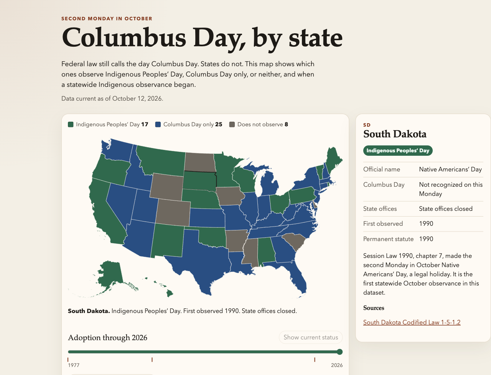

# Columbus Day, by state

A map of how each U.S. state treats the second Monday in October: Indigenous Peoples’ Day, Columbus Day only, or neither. The year slider shows when a statewide Indigenous observance began.



States that recognize both holidays are shown as Indigenous Peoples’ Day. The detail panel lists the official name, whether state offices close, the first observance year, the statute year when it differs, and sources.

## Run locally

```bash
npm install
npm run dev
```

Then open http://localhost:5173. `npm test` checks that the dataset has all 50 states.

## Data

The records live in [`src/data/states.ts`](src/data/states.ts). There is no database. The nationwide baseline is the [Pew Research Center review from October 7, 2025](https://www.pewresearch.org/short-reads/2025/10/07/columbus-day-indigenous-peoples-day-or-just-a-regular-monday-it-depends-on-where-you-are/), checked against state statutes and official holiday schedules. District of Columbia and U.S. territories are not on the map.
